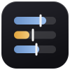

# usagetop

How much of each AI subscription is left: Claude, ChatGPT, Mistral, Kimi and Muse.
Every limit with its pace and a forecast of when it runs out, in a Windows tray
app, a macOS menu bar app, an Android app and widget, and the server's web dashboard.

| Folder | What it is |
|---|---|
| `my-usage-android/` | The Android app and its home-screen widget (Kotlin) |
| `my-usage-win/` | The Windows tray app (WPF, .NET 9), plus `AiUsage.Core`, the UI-free library |
| `my-usage-mac/` | The macOS menu bar app (SwiftUI, SwiftPM) |
| `my-usage-server/` | An always-on poller with a history database and an HTTP API, built on `AiUsage.Core` |

Each app fetches for itself until it is given a server address in its Settings.
From then on it reads everything from the server, which does the fetching, keeps
the history and holds the sign-ins for both. The server also has a page of its
own: open its address in a browser. See `my-usage-server/README.md`.

## Installing

Windows: download `usagetop-win-Setup.exe` from the Releases page and run it. It
installs for your user only (no admin prompt), adds a Start menu entry, and
fetches the .NET 9 desktop runtime first if it is missing. The other apps are
built from source for now (below).

## Building and testing

```
# Windows app and shared library
dotnet build my-usage-win/src/AiUsage -c Release
dotnet test  my-usage-win/tests/AiUsage.Core.Tests

# Server
dotnet test  my-usage-server/tests/AiUsage.Server.Tests
dotnet run --project my-usage-server/src/AiUsage.Server

# Android (needs JAVA_HOME pointing at a JDK 17+)
cd my-usage-android
./gradlew testDebugUnitTest assembleDebug

# macOS (needs Xcode 26)
cd my-usage-mac
./build.sh

# Windows installer and update packages, into my-usage-win/build/releases
# (needs: dotnet tool install -g vpk --version 1.2.161)
./my-usage-win/pack.ps1
```

## One rule that cuts across all three

Claude's and ChatGPT's refresh tokens are single-use. Any session must have
exactly one holder that renews it, or whichever renews first signs the other
out. So the Windows app borrows a CLI's access token rather than copying its
refresh token, the Android app shares one fetch between its worker, widget and
screens, and an app that is pointed at a server stops fetching altogether. A
session reaches the server either by signing in there or by the Windows app
moving its own across, after which the app forgets it.

The provider logic exists twice, in Kotlin and in C#. The arithmetic they share
(combined figure, trendline, projection, history thinning, provider parsing) is
covered by the same tests on both sides; change one and its twin should change
too.

## License

MIT, see `LICENSE`. The Windows app bundles the Inter typeface, under the SIL
Open Font License (`my-usage-win/src/AiUsage/Assets/Fonts/OFL.txt`).

This project is not affiliated with or endorsed by Anthropic, OpenAI, Mistral AI,
Moonshot AI or Meta. Their names and logos are trademarks of their owners and are
shown only to tell the accounts apart. The apps read usage through the same
endpoints the providers' own apps and CLIs use, which are not public APIs and can
change or stop working without notice.
