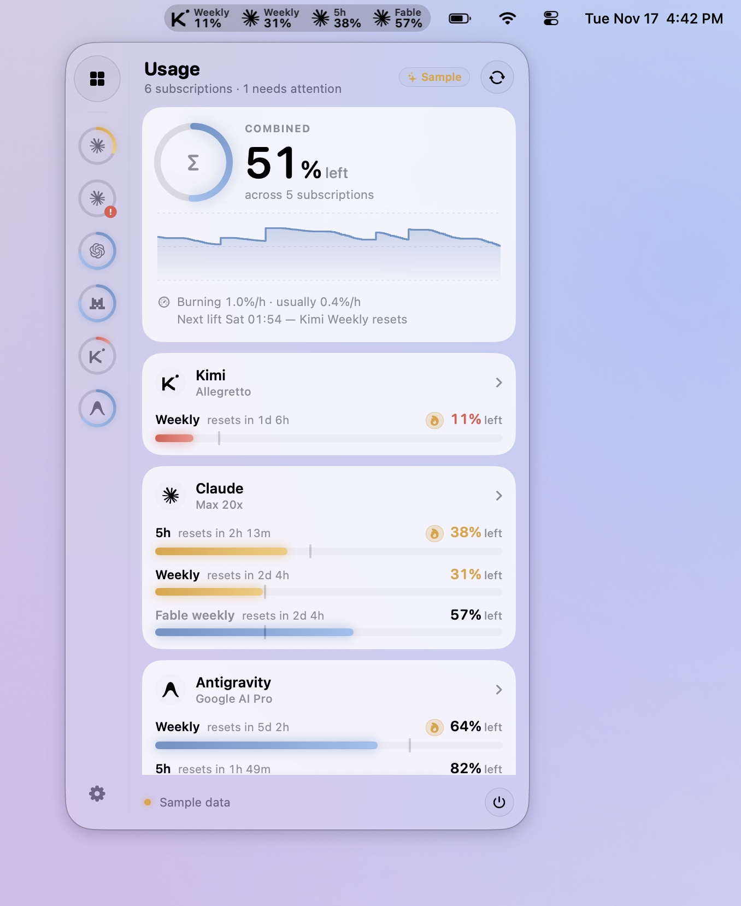
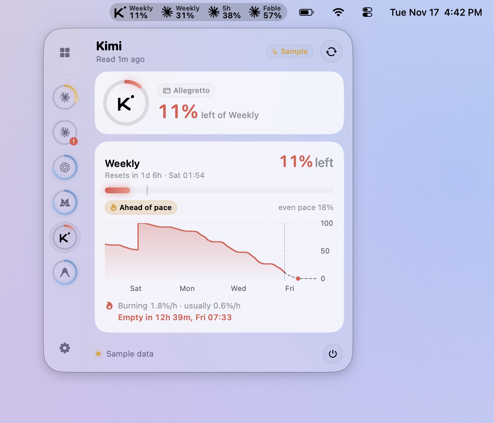
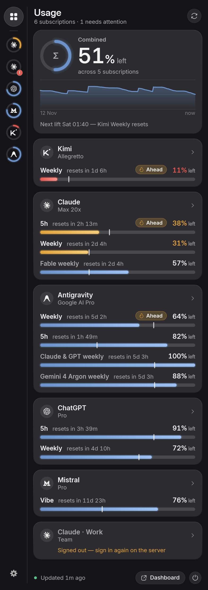
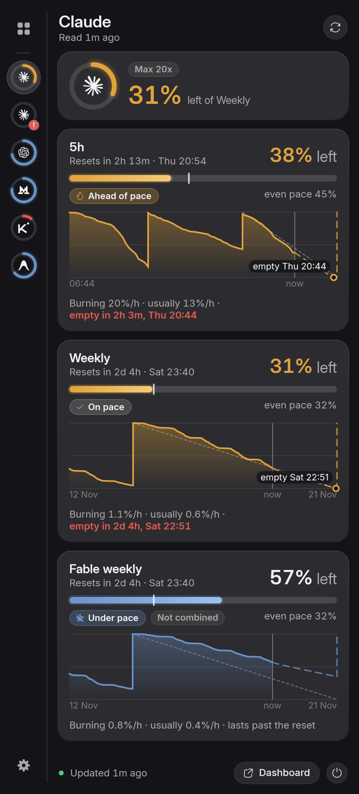
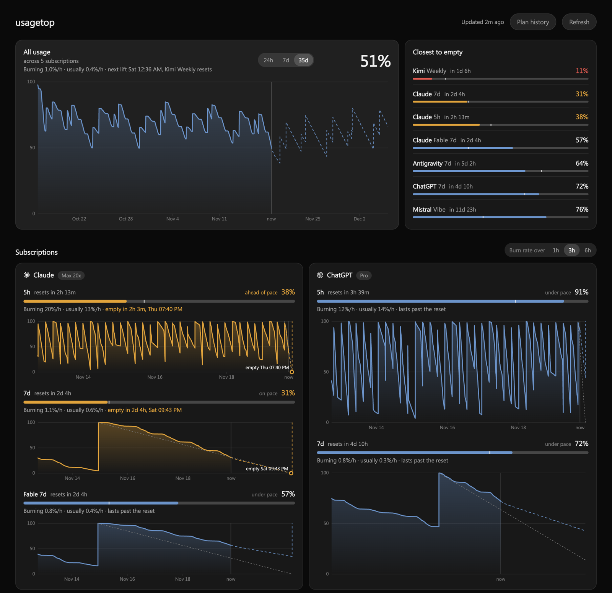

<p align="center"></p>

<h1 align="center">usagetop</h1>

<p align="center">
How much of each AI subscription is left, and whether it will last until it resets.<br>
Claude · ChatGPT · Mistral · Kimi · Muse · Google AI (Antigravity)
</p>

<p align="center">
<a href="https://github.com/rzukic/usagetop/releases/latest/download/usagetop-mac.dmg">macOS</a> ·
<a href="https://github.com/rzukic/usagetop/releases/latest/download/usagetop-win-Setup.exe">Windows</a> ·
<a href="https://github.com/rzukic/usagetop/releases/latest/download/usagetop-android.apk">Android</a> ·
<a href="#your-own-server">Server</a>
</p>

<p align="center">
<picture>
  <source media="(prefers-color-scheme: dark)" srcset="docs/screenshots/mac-dark.jpg">
  
</picture>
</p>

<p align="center"><sub>The macOS app, with sample data: the menu bar shows the four limits closest to running out, the panel everything. Every picture here is made-up usage.</sub></p>

## What it tells you

Every provider has its own limits, its own reset times and its own page to look
them up on. usagetop asks all of them every few minutes and puts the answers in
one place, with the history and a forecast. In the picture above:

- **What runs out first.** Kimi's weekly limit has 11% left and resets in 1 day
  6 hours. At the pace of the last three hours it is empty in 12 hours, long
  before the reset, so it is red and at the top of the list.
- **Whether you are ahead of pace.** Claude's 5-hour window has 38% left with
  2 hours 13 minutes to go. The tick on each bar is where an even spread over
  the window would be; a flame means you are spending faster than that.
- **One figure for everything.** 51% left across five subscriptions: each
  subscription's long limit (weekly or monthly; 5-hour windows say nothing about
  the week) averaged, burning 1.0% an hour against a usual 0.4%, with the next
  refill on Saturday when Kimi resets.
- **Every limit a provider has.** Antigravity on a Google AI Pro plan has four:
  Gemini's weekly and 5-hour limits, a separate pool for Claude and GPT models,
  and Gemini Argon's own weekly one. Only the main allowance counts toward the
  combined figure; the others are shown beside it.

<p align="center">
<picture>
  <source media="(prefers-color-scheme: dark)" srcset="docs/screenshots/mac-detail-dark.jpg">
  
</picture>
</p>

Click an account for its history and forecast: the last week of Kimi, the pace
it is being spent at, and when it runs dry if nothing changes. The menu bar
shows the combined figure in a ring, or the one to four limits closest to
running out.

## The apps

Each app works on its own: add the subscriptions you have in its Settings, sign
in or paste a key, and it asks the providers itself and keeps the history on
that device. Nothing goes anywhere but to the providers, and to GitHub to look
for updates.

| | |
|---|---|
| **macOS** | A menu bar app with a Liquid Glass panel. macOS 26, Apple silicon and Intel. Signed and notarized; updates itself. |
| **Windows** | A tray icon with a flyout panel and a full window. Windows 10 and 11. Updates itself. |
| **Android** | An app and a home-screen widget. Android 8 and newer. Updates itself. |
| **Server** | Optional: polls around the clock, keeps one history for all your devices and holds the sign-ins, with a web page of its own. Linux, Docker. |

<p align="center">

&nbsp;&nbsp;

</p>

<p align="center"><sub>The Windows tray panel: everything at once, and one account with its history and forecast.</sub></p>

### Your own server

A server is worth it once you use more than one device: the phone and the PC
show the same history, nothing has to be awake to record it, and each sign-in
lives in one place. It is one container:

```sh
docker run -d --name usagetop -p 8377:8377 -v usagetop-data:/data \
  ghcr.io/rzukic/usagetop-server
docker exec usagetop dotnet aiusage-server.dll token   # the token the apps ask for
```

Open `http://<host>:8377`, add your accounts and sign in there, then give each
app the address and the token in its Settings. The page shows everything the
apps do:

<p align="center"></p>

`my-usage-server/README.md` has the settings, the API, a systemd unit for running
it without Docker, and where to put it (a machine at home beats a rented one).

### Supported subscriptions

| Provider | What it reads | How you connect |
|---|---|---|
| Claude (Pro, Max, Team) | 5-hour, weekly, and per-model weekly limits | Sign in with Claude, in the browser |
| ChatGPT (Plus, Pro, Team) | 5-hour and weekly limits | Sign in with ChatGPT, in the browser |
| Google AI Pro / Ultra (Antigravity) | Every model group's weekly and 5-hour limits | Sign in with Google, in the browser |
| Muse Code (Meta) | 5-hour and weekly limits | A code to approve in the browser |
| Kimi Code | 5-hour and monthly limits, or prepaid balance | API key |
| Mistral | Vibe allowance and API credit | API key |

The sign-ins ask for as little as each provider allows (Claude's cannot run
models or create API keys), and the tokens stay on your device or your server,
encrypted.

## Installing

These links always give the latest release; earlier ones and betas are on the
[Releases page](https://github.com/rzukic/usagetop/releases).

- **Windows:** download
  [`usagetop-win-Setup.exe`](https://github.com/rzukic/usagetop/releases/latest/download/usagetop-win-Setup.exe)
  and run it. It installs for your user only (no admin prompt), adds a Start
  menu entry, and fetches the .NET 9 desktop runtime first if it is missing.
  From then on the app updates itself.
- **Android:** download
  [`usagetop-android.apk`](https://github.com/rzukic/usagetop/releases/latest/download/usagetop-android.apk)
  on the phone and open it; Android asks once to allow installing from your
  browser. From then on the app updates itself: it downloads a new release in
  the background, and Settings → Updates has **Install**. The first time,
  Android asks whether usagetop may install apps and to confirm; after that,
  on Android 12 and newer, updates go in by themselves while the app is not
  on screen.
- **Server:** unpack
  [`usagetop-server-linux-x64.tar.gz`](https://github.com/rzukic/usagetop/releases/latest/download/usagetop-server-linux-x64.tar.gz)
  (or
  [`-arm64`](https://github.com/rzukic/usagetop/releases/latest/download/usagetop-server-linux-arm64.tar.gz))
  and start `./usagetop-server/aiusage-server`; nothing else to install. Or
  run the image, built for x64 and arm64:
  `docker run -d -p 8377:8377 -v usagetop-data:/data ghcr.io/rzukic/usagetop-server`.
  For the settings, see `my-usage-server/README.md`.
- **macOS:** download
  [`usagetop-mac.dmg`](https://github.com/rzukic/usagetop/releases/latest/download/usagetop-mac.dmg),
  open it and drag `usagetop` onto Applications. It needs macOS 26 and runs
  on Apple silicon and Intel. The app is signed with a Developer ID and
  notarized by Apple, so it opens like any other download. From then on it
  updates itself, as long as it is in the Applications folder: it downloads a
  new release in the background and puts it in when you restart or quit
  (Settings → Updates).

## Building and testing

```
# Windows app and shared library
dotnet build my-usage-win/src/AiUsage -c Release
dotnet test  my-usage-win/tests/AiUsage.Core.Tests

# Server
dotnet test  my-usage-server/tests/AiUsage.Server.Tests
dotnet run --project my-usage-server/src/AiUsage.Server

# Android (needs JAVA_HOME pointing at a JDK 17+)
cd my-usage-android
./gradlew testDebugUnitTest assembleDebug

# macOS (needs Xcode 26), into my-usage-mac/usagetop.app
cd my-usage-mac
./build.sh

# Windows installer and update packages, into my-usage-win/build/releases
# (needs: dotnet tool install -g vpk --version 1.2.161)
./my-usage-win/pack.ps1
```

## Releasing

One version number covers the whole project, and each version is one GitHub
Release. For now a release is built on the maintainer's machine:

```
# 1. Bump <Version> in my-usage-win/src/AiUsage/AiUsage.csproj, commit and push
# 2. Build and publish it (needs vpk and gh, see the script's header)
./release.ps1
# 3. On a Mac, add the Mac app and the server's image to that release
#    (needs Xcode 26, gh and Docker, see the script's header)
./release-mac.sh
```

`release.ps1` refuses a version that is not SemVer, runs the tests, and builds
every app it can with that version: the Windows installer with a delta package
against the previous release, the signed Android APK, and the server for Linux
on x64 and arm64. Then it pushes the tag `v<version>` and publishes the release
with generated notes. `./release.ps1 -Version 1.2.1-beta.1` makes a pre-release
instead: the apps offer it only to those who opted into betas, and the download
links above keep pointing at the last stable release.

`release-mac.sh` does what only a Mac can, for the latest release or the one
named (`./release-mac.sh 1.2.1`): it builds the Mac app for Apple silicon and
Intel with that version, packs it in a disk image and attaches
`usagetop-mac.dmg` to the release; then it builds the server's image for `linux/amd64` and
`linux/arm64`, starts it once on an empty volume to see that it serves its page
and can write its data, and pushes it to `ghcr.io/rzukic/usagetop-server` as
`<version>` and `latest` (a pre-release leaves `latest` alone). The Mac app is
signed with the Developer ID certificate in the maintainer's keychain and
notarized by Apple, and so is the disk image; the script's header says what that
needs. A copy built without a certificate is signed ad hoc: it runs on the Mac
that built it, and anywhere else macOS has to be told to open it (System
Settings → Privacy & Security → Open Anyway).

The Android APK is signed with a key that is kept outside the repository (the
script's header says where). Every release must use the same key, or phones
refuse the update.

`.github/workflows/release.yml` builds the Windows part from a pushed tag on
GitHub Actions, and `ci.yml` builds and tests every push and pull request. Both
are switched off in the repository's Actions settings for the time being.

## One rule that cuts across all of them

Claude's and ChatGPT's refresh tokens are single-use. Any session must have
exactly one holder that renews it, or whichever renews first signs the other
out. So the Windows app borrows a CLI's access token rather than copying its
refresh token, the Android app shares one fetch between its worker, widget and
screens, and an app that is pointed at a server stops fetching altogether. A
session reaches the server either by signing in there or by the Windows app
moving its own across, after which the app forgets it.

The provider logic exists three times: in C# (the Windows app and the server),
in Kotlin (Android) and in Swift (the Mac app without a server). The arithmetic
they share (combined figure, trendline, projection, history thinning, provider
parsing) is covered by the same tests on each side; change one and its twins
should change too.

## License

MIT, see `LICENSE`. The Windows app bundles the Inter typeface, under the SIL
Open Font License (`my-usage-win/src/AiUsage/Assets/Fonts/OFL.txt`). The
provider marks are from simple-icons (CC0), Antigravity's from LobeHub's icon set
(MIT).

This project is not affiliated with or endorsed by Anthropic, OpenAI, Mistral AI,
Moonshot AI, Meta or Google. Their names and logos are trademarks of their owners and are
shown only to tell the accounts apart. The apps read usage through the same
endpoints the providers' own apps and CLIs use, which are not public APIs and can
change or stop working without notice.
